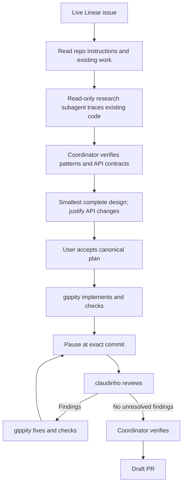

# Five-knuckle-shuffle

Use only Gippity and Claudinho for this workflow. The coordinator owns the outcome, plan, actual diff, verification, and draft PR. `gippity` owns implementation; `claudinho` reviews independently. The objective is to satisfy the requested behavior with the simplest complete design and code that fit the existing codebase. Minimize concepts, interfaces, state, and changed behavior before line count. Simplicity is an acceptance criterion from the start, not a cleanup pass after implementation.

Read `herdr`, `ponytail`, and `ponytail-review`, using authoritative repo copies where required. Load `unslop` and `dont-sound-like-ai` only when applicable under the user's writing rules. Follow `herdr` for CLI discovery, IDs, layout, agent lifecycle, and prompt delivery. Apply `ponytail` during research, planning, implementation, and review. Apply writing skills only where the user's writing rules call for them.

## Plan mode

A new feature starts in plan mode and stays there until the user accepts the plan. Do that every time, including when the feature looks small. Do not create the worktree, launch `gippity` or `claudinho`, or edit implementation files before acceptance. A read-only research subagent is required before acceptance; it is separate from the implementation and review sessions.

Before drafting or proposing the plan, complete the repo-pattern inspection below. Entering plan mode does not replace that inspection.

Use Gippity's available planning controls; if the host has no plan-mode switch, maintain the same read-only boundary explicitly. After the user accepts the plan, continue below; reuse an already accepted plan rather than asking for the same approval again. Acceptance does not waive research: for a resumed or accepted plan missing the evidence below, complete and verify it before implementation. Preserve the existing approval unless findings change the accepted behavior or scope.

## Establish context

Fetch the live Linear issue, comments, acceptance criteria, dependencies, and linked canonical plans through available connectors. Read applicable `AGENTS.md` files and repo setup instructions.

Inspect worktrees, branches, PRs, issue activity, and existing sessions to identify overlapping work, ownership, and blockers. Reuse matching work safely; resolve ownership before taking over an active implementation. Check `git worktree list` and `git rev-parse --git-common-dir --is-bare-repository` to establish the repo layout.

Where Notion is required, search the repo/project hubs before creating a feature page. Reuse one canonical page, keep its plan/status/diagram and worktree records current, and fetch saved changes to verify them. Follow required planning gates and reuse approved decisions. Ask for unresolved product choices while continuing independent work.

## Inspect existing patterns before planning

Before making design decisions or drafting a plan, launch a read-only Gippity research subagent against the actual target checkout. Give it the requested behavior, acceptance criteria, and repo instructions, without a preferred design to rubber-stamp. It must trace the relevant path from entry point through its owners, dependencies, callers, and tests, and inspect the closest working examples in the same product. Searching filenames or promising to read code later does not count. Do not start implementation while this research is pending. If research cannot run, report that missing prerequisite rather than claiming the gate passed.

Require a compact report with:

- Concrete `file:line` or symbol references for the current flow and closest implementations, including naming, API shape, authentication, validation, storage, and test conventions where relevant.
- Existing owners, APIs, SDKs, types, and mechanisms that already provide the behavior; relevant callers and observable contracts that must survive the change.
- The smallest extension that could meet the requirement, likely files to touch, and evidence for anything that actually needs a new interface or changed contract.
- Conflicting patterns, missing evidence, and overlapping work that could invalidate the recommendation.

The coordinator reads the cited code and verifies the conclusions before planning. Follow current patterns in the target product; examples from another product or an unmerged branch are evidence to evaluate, not automatically the convention. Record the findings beside the design in the canonical plan. For a bug, compare the failing path with the known-working code, dependency versions, and configuration before adding a workaround. Re-run focused research when scope or the relevant base changes.

## Choose the simplest complete change

Apply Ponytail's ladder before choosing the design: existing behavior, existing owner/API, existing standard-library or installed dependency, then the minimum new code. State the user-visible result, the existing path being reused, the intended change surface, and what current requirement makes each new concept necessary. If a smaller approach cannot work, give the concrete reason; do not generate elaborate alternative architectures just to satisfy this check.

Preserve existing APIs by default: signatures, request/response shapes, naming, authentication, errors, and storage semantics. Before changing one, trace its callers and record the unmet requirement or reproduced defect, why using the current API cannot solve it, and the affected consumers and focused compatibility checks. A feature-specific inconvenience, mock limitation, or cleaner-looking abstraction does not justify a shared contract change. Fix a proven shared defect at its owner, but do not use a feature to redesign otherwise working APIs.

Do not add wrappers, traits, extra crates, endpoints, configuration switches, concurrency, state, or compatibility machinery for hypothetical future consumers. Keep research provenance in notes unless a current runtime consumer needs it; extend existing documentation instead of creating a second instruction source. For prototypes, establish an actual deployed-data or caller compatibility requirement before adding migrations or versioning solely to preserve disposable state. This never authorizes resetting data. Reuse the existing test seam and test observable behavior; do not add a framework or retain redundant tests to justify an abstraction. A dev check does not justify a permanent production endpoint, feature flag, or IAM surface.

Simplicity must preserve the requested behavior, authorization, error handling, and rejected inputs. Keep input parsing and validation at the API boundary, and Rust domain behavior on its existing owning types. Pass storage object names unchanged to SDK methods; investigate SDK/transport defects rather than rewriting shared object-key semantics. Do not replace a working security or reliability boundary merely to reduce lines.

Before presenting the plan, check that every proposed API change and new abstraction has this evidence. Keep unrelated cleanup out of the task. If implementation reveals a necessary expansion, update the evidence and plan before proceeding with that expansion; obtain a decision only when it changes the accepted behavior or scope.

## Prepare the work

Follow the Herdr skill and the user's applicable remote-session rules before Herdr inspection or control. Discover actual IDs; do not infer a remote session merely from an unset `HERDR_ENV`.

Update main and sync skills according to the repo's actual rules before feature work. Preserve local changes and existing layout; stop unsafe updates rather than reset, rebase, or stash someone else's work.

Create or reuse the feature worktree and branch from the required starting ref. Under the user's convention, use `<repo>/<feature>` and `shrey/<feature>`; never check the feature branch out in `main`. Record the worktree, branch, starting ref, and canonical plan.

Create an issue-named Herdr tab in that worktree, vertically split into side-by-side panes. Launch `gippity` on the left and `claudinho` on the right using discovered effective alias commands, preserving their permission flags. Always run Claudinho reviews on Opus with high reasoning: explicitly set `--model opus --effort high` on the resolved Claude command, including resumed review sessions. Verify these options against the installed CLI and confirm the effective model and effort before sending the review. Never silently fall back to another model or lower effort; report an unavailable required configuration. Verify agent identity and readiness through Herdr. For long prompts loaded from files, use supported inputs or an argument-array subprocess; never interpolate prompt text into shell code.

Use the user's current authorization for trust prompts concerning this verified repo after checking the prompt and repo identity. It does not authorize unrelated paths, actions, or approval dialogs. Follow Herdr's guidance for those and uncertain prompt delivery.

## Implement, review, and fix

Give both sessions the original issue, canonical plan, acceptance criteria, repo instructions, reference implementations, convention findings, and justified deviations. Include the research report, intended change surface, preserved contracts, and smallest-design rationale, plus relevant skill references. Do not pass only a ticket and a general instruction to use Ponytail. `gippity` is the single implementation writer and owns edits, commits, and checks. The reviewer must not mutate implementation files. It reviews the actual behavior and connected code independently of the implementer's summary, including whether the diff follows the identified conventions and whether any deviation remains justified.

1. Have `gippity` finish checks, commit the candidate, and pause implementation. Inspect status yourself; resolve uncommitted implementation changes while preserving unrelated work. Record immutable base and head SHAs for the full diff.
2. Have `claudinho` review that exact commit against the requirements. Require concrete findings with file/line, failure case, and smallest fix. Also require a necessity review: for each changed API or added abstraction, identify the current requirement it serves and whether the existing path suffices. Treat unjustified API churn or complexity as actionable findings, even when tests pass. Reviewer suggestions do not expand scope; accept added machinery only for a demonstrated in-scope failure. Distinguish actionable defects, suggestions, and product decisions. Run `ponytail-review` before delivery.
3. Inspect findings and code yourself, then send actionable fixes back to `gippity`. It fixes, reruns relevant checks, commits, and pauses. Re-review the new head and full final diff. Any subsequent candidate edit repeats this loop, including prose edits from `unslop`.
4. Confirm the reviewed head and implementation status remain unchanged. The coordinator inspects the actual final diff and verifies acceptance criteria through relevant tests or live behavior, beyond session reports or compilation. Compare the full diff to the planned change surface; remove unsupported additions and verify existing callers/contracts still work. Record any justified expansion.

Continue until no actionable findings remain within scope. Report blocked or inconclusive checks honestly. If access, a product decision, or repeated unresolved failure prevents progress, preserve the work and report the blocker instead of cycling indefinitely or claiming completion.

## Deliver a draft

Create new PRs as DRAFT after required checks and review; preserve the status of an existing PR when updating it. Follow repo PR rules. Never include Notion references in PR descriptions. Claudinho owns independent review; do not invoke external review bots. Route its actionable findings through the same loop.

Verify a new PR is a draft (or an existing PR retains its prior status) and its head matches the reviewed SHA. Hand back issue/PR links, canonical plan, worktree/branch, reviewed SHA, verification results, and unresolved blockers or decisions. Never merge, deploy, mark ready, or mark the issue complete without explicit authorization.
