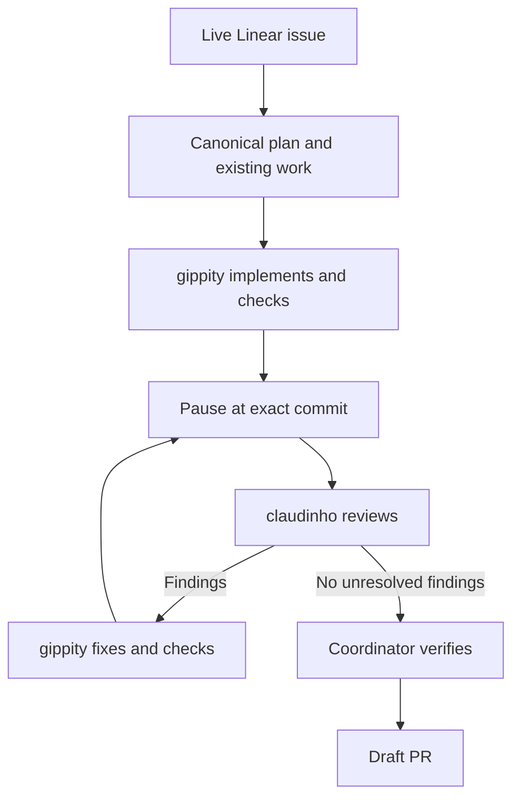

# Five-knuckle-shuffle

The coordinator owns the outcome, plan, actual diff, verification, and draft PR. `gippity` owns implementation; `claudinho` reviews independently. Reduce the user's review burden without claiming human review is unnecessary.

Read `herdr`, `ponytail`, `ponytail-review`, `unslop`, and `dont-sound-like-ai`, using authoritative repo copies where required. Follow `herdr` for CLI discovery, IDs, layout, agent lifecycle, and prompt delivery. Apply `ponytail` throughout implementation and both writing skills to prose.

## Establish context

Fetch the live Linear issue, comments, acceptance criteria, dependencies, and linked canonical plans through available connectors. Read applicable `AGENTS.md` files and repo setup instructions.

Inspect worktrees, branches, PRs, issue activity, and existing sessions to identify overlapping work, ownership, and blockers. Reuse matching work safely; resolve ownership before taking over an active implementation. Check `git worktree list` and `git rev-parse --git-common-dir --is-bare-repository` to establish the repo layout.

Where Notion is required, search the repo/project hubs before creating a feature page. Reuse one canonical page, keep its plan/status/diagram and worktree records current, and fetch saved changes to verify them. Follow required planning gates and reuse approved decisions. Ask for unresolved product choices while continuing independent work.

## Prepare the work

Before any Herdr inspection or control, verify `HERDR_ENV=1`; stop if outside Herdr. Discover actual IDs through the Herdr skill.

Update main and sync skills according to the repo's actual rules before feature work. Preserve local changes and existing layout; stop unsafe updates rather than reset, rebase, or stash someone else's work.

Create or reuse the feature worktree and branch from the required starting ref. Under the user's convention, use `<repo>/<feature>` and `shrey/<feature>`; never check the feature branch out in `main`. Record the worktree, branch, starting ref, and canonical plan.

Create an issue-named Herdr tab in that worktree, vertically split into side-by-side panes. Launch `gippity` on the left and `claudinho` on the right using discovered effective alias commands, including their flags and model choices. Verify agent identity and readiness through Herdr. For long prompts loaded from files, use supported inputs or an argument-array subprocess; never interpolate prompt text into shell code.

Use the user's current authorization for trust prompts concerning this verified repo after checking the prompt and repo identity. It does not authorize unrelated paths, actions, or approval dialogs. Follow Herdr's guidance for those and uncertain prompt delivery.

## Implement, review, and fix

Give both sessions the original issue, canonical plan, acceptance criteria, repo instructions, and relevant skill references. `gippity` is the single implementation writer and owns edits, commits, and checks. The reviewer must not mutate implementation files. It reviews the actual behavior and connected code independently of the implementer's summary.

1. Have `gippity` finish checks, commit the candidate, and pause implementation. Inspect status yourself; resolve uncommitted implementation changes while preserving unrelated work. Record immutable base and head SHAs for the full diff.
2. Have `claudinho` review that exact commit against the requirements. Require concrete findings with file/line, failure case, and smallest fix. Distinguish actionable defects, suggestions, and product decisions. Run `ponytail-review` before delivery.
3. Inspect findings and code yourself, then send actionable fixes back to `gippity`. It fixes, reruns relevant checks, commits, and pauses. Re-review the new head and full final diff. Any subsequent candidate edit repeats this loop, including prose edits from `unslop`.
4. Confirm the reviewed head and implementation status remain unchanged. The coordinator inspects the actual final diff and verifies acceptance criteria through relevant tests or live behavior, beyond session reports or compilation.

Continue until no actionable findings remain within scope. Report blocked or inconclusive checks honestly. If access, a product decision, or repeated unresolved failure prevents progress, preserve the work and report the blocker instead of cycling indefinitely or claiming completion.

## Deliver a draft

Create or update a DRAFT PR after required checks and review. Follow repo PR rules. Route returned actionable findings through the same loop.

Verify the remote PR is a draft and its head matches the reviewed SHA. Hand back issue/PR links, canonical plan, worktree/branch, reviewed SHA, verification results, and unresolved blockers or decisions. Never merge, deploy, mark ready, or mark the issue complete without explicit authorization.
